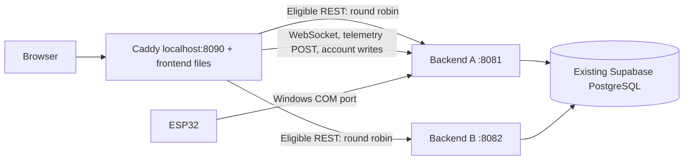

# Windows REST load balancing demo

**REST API load balancing implemented; telemetry remains on a dedicated instance**



## Routing and safety

`deploy/Caddyfile.load-balanced` is separate from the existing single-instance Caddy/Compose files. This demo does not use the sample PostgreSQL container or pass Windows COM devices to Linux containers.

Ordered `route` handlers pin POST/PUT/PATCH/DELETE under `/api/telemetry`, `/api/users`, and `/api/auth` to A, followed by `/ws*` to A. Account writes must run on A because `WebSocketSessions.AccountChanged` closes sockets in the current JVM after transaction commit. All browser sockets live on A. Other `/api/*` requests use explicit round robin. No Caddy request retries are configured, including writes. A failed in-flight request can fail; after the health check detects B's failure, subsequent eligible requests use A. Do not manually replay an uncertain write without checking its result.

The loopback-only `/internal/available` returns no body: 204 when the application is accepting traffic and `SELECT 1` succeeds, otherwise 503 (403 for remote callers). The gateway returns 404 for `/internal/*`. It does not expose operations/readiness; `/api/operations/**` remains ADMIN-only. This probe is not a hardware, recording, or distributed readiness guarantee. Caddy checks it every two seconds with a two-second timeout; passive failure marking lasts three seconds. Upstream dial timeout is two seconds and response-header timeout is 30 seconds. Native WebSocket proxy upgrades remain on A, without a lifetime timeout.

## Prerequisites and environment

Java 21, Node/npm with existing frontend dependencies, and a native Windows Caddy executable on PATH (or `-Caddy C:\tools\caddy.exe`). Close Arduino Serial Monitor before A opens the controller COM port. Existing single-instance processes are never stopped automatically; if port 8081 is occupied, identify its terminal and stop it yourself with Ctrl+C before switching modes.

Set the existing variables in BOTH backend terminals using your existing secure configuration:

| Variable | Purpose |
|---|---|
| `DB_URL` | Existing Supabase session-pooler JDBC URL with TLS, port 5432 |
| `DB_USERNAME` | Existing pooler database username |
| `DB_PASSWORD` | Database password; never commit or print |
| `APP_ADMIN_PASSWORD` | Only needed if the database has no admin; not an existing-password reset |

No Supabase service-role key is used. Do not paste secrets into commands/history. For a missing database password use `$env:DB_PASSWORD = (Get-Credential -UserName 'database' -Message 'Database password').GetNetworkCredential().Password` locally. Do not change a populated schema for this demonstration.

The launcher selects the existing `supabase` profile, `flightsimulation` schema, and database variables. A initializes first; B waits for A's availability before starting. Flyway runs on A only, and B validates the existing schema with Flyway disabled. Pool size is two per instance (four total), minimum idle one each; verify this fits your Supabase connection allowance alongside other clients. CLI overrides enforce these deployment settings without changing the single-instance defaults.

## Start and stop (repository root, three PowerShell terminals)

Terminal 1, with database environment configured:

```powershell
.\scripts\start-load-balanced.ps1 -Component A -SerialPort COM3 -FlightId 1
```

Wait until A is ready; Terminal 2, with the same database environment:

```powershell
.\scripts\start-load-balanced.ps1 -Component B
```

Terminal 3:

```powershell
.\scripts\start-load-balanced.ps1 -Component Gateway
```

Open `http://localhost:8090`. Gateway builds the existing frontend with `VITE_BACKEND_URL=http://localhost:8090`; both API and WebSocket URLs therefore use one origin. It restores the terminal's build variables afterwards. For another gateway port, pass the SAME `-GatewayPort 8095` to all three commands. Backend ports remain 8081/8082, bound to loopback. B always receives `flightsimulation.serial.enabled=false`; A receives true and the specified COM port/flight ID. B's recorder has no serial producer, and gateway ingestion is pinned to A; there is no replication of samples to B.

Stop each process using Ctrl+C in its own terminal: gateway, B, then A. For a failure demo, stop ONLY B with Ctrl+C in Terminal 2, wait five seconds, then run the read check; restart B with its same command, wait for readiness and five more seconds, then repeat. Stopping A interrupts serial ingestion, WebSocket delivery, account changes, and REST telemetry ingestion even while other REST APIs can reach B.

Original single-instance commands and deployment files remain usable. The gateway build embeds its origin in `frontend/dist`; rebuild with your original `VITE_BACKEND_URL` when switching deployment targets. Vite development startup remains unchanged.

## Read-only load verification

```powershell
.\scripts\test-load-balanced.ps1
# Or customize the bounded read test:
.\scripts\test-load-balanced.ps1 -Gateway http://localhost:8090 -Requests 20 -Concurrency 4
```

The secure credential prompt uses existing application credentials. Only GET `/api/aircraft` requests are sent. The script displays `X-Backend-Instance`, status, per-request time, per-instance counts, mean/p95 times, and errors, without printing credentials. Ten healthy sequential requests should alternate and yield five per instance when no other eligible traffic interleaves. Concurrent traffic, other browser requests, and failure transitions need not split exactly equally. This is a bounded smoke demonstration, not a capacity benchmark. Do not run destructive permission tests against live data.

## Disposable automated verification

Build the backend and frontend first, then:

```powershell
.\backend\mvnw.cmd -f backend/pom.xml test package
npm --prefix frontend run build
.\scripts\verify-load-balanced-isolated.ps1 -Caddy C:\tools\caddy.exe
```

The harness uses ports 18081/18082/18090, serial disabled on both instances, a NEW temporary shared H2 file with AUTO_SERVER, generated test credentials, and native Caddy. It never uses the configured Supabase URL or modifies its tables. It starts A before B; creates disposable users/aircraft/flight; checks alternating read headers, bounded concurrency, role denials through the gateway, owner account writes, WebSocket subscription plus REST telemetry broadcast, and identical single-row telemetry from both backends. It stops only its own B, verifies A-only reads after detection, restarts B, verifies rejoin, and cleans up its own processes. Temporary database and logs are retained for inspection. The H2 test is not proof of Supabase pooling, TLS, network latency, or live hardware behavior.

The harness also builds static files for its test gateway origin and checks SPA fallback. Its ignored `frontend/dist` therefore targets port 18090 afterwards; the normal gateway launcher always rebuilds for its selected port.

### Executed verification (2026-10-25)

- Existing backend suite: 91 tests passed; two additional instance-header/availability tests passed separately. Backend executable package built successfully.
- Native Caddy configuration validated. Disposable two-process Spring/H2/Caddy test passed: 10 sequential reads alternated 5/5; bounded concurrent reads returned no errors; stopping B produced 10/10 reads from A; restarting B restored 5/5.
- VIEWER mutation and OPERATOR administration requests returned 403 through the gateway; ADMIN administration remained accessible. Account PATCH ran on A and closed the viewer WebSocket with policy code 1008.
- Telemetry POST ran on A and delivered its sample over the gateway WebSocket. Both instances returned the same single telemetry row and identical CSV exports, with no duplicate persisted sample from the REST test.
- The standalone PowerShell read script ran against the disposable gateway, including concurrent reads and timing/error summaries. Frontend production build passed with the existing large simulator-chunk warning.
- No physical serial input or live Supabase verification was performed. Existing simulator controls/audio were not changed or manually retested in this deployment task. The REST broadcast test does not prove physical sensor recording.

## Security and remaining limitations

- Existing HTTP Basic role rules and database-backed account lookups are unchanged. Hiding controls is not authorization. Backend ports are loopback-only; browser traffic must use the gateway. Direct local API writes bypass routing guarantees.
- Password/access changes sent through the gateway run on A, preserving current socket revocation. Direct calls to B or external database edits cannot revoke A's existing sockets. Do not administer accounts outside the gateway during the demo.
- `AuthenticationThrottle` is still per JVM and sees the local proxy IP; failures are not shared between instances and may throttle unrelated clients together. STOMP authentication has its existing separate behavior. A trusted-proxy-aware shared throttle and distributed revocation are separate security work, not implemented here.
- There is no distributed STOMP broker, hardware failover, queue replication, full high availability, automatic scaling, or recording guarantee. Hardware readings are persisted only by the owner path; live connectivity alone does not prove persistence.
- Supabase profile uses the existing schema/migrations. Live TLS connectivity, connection allowance, physical COM ownership, sensor motion, and recording under real cloud backpressure require an operator check on the target computer.

## EAD presentation sequence

1. Show the diagram and explain why serial/telemetry has one owner.
2. Start A, B, gateway and sign in through port 8090; show unchanged simulator/UI.
3. Run the read-only script and show alternating response labels/counts.
4. Show VIEWER read-only UI and existing role restrictions; use the disposable harness output for mutation-denial evidence.
5. Stop only B, wait, show A-only reads; restart B and show both labels return.
6. With actual hardware, verify live telemetry on A and saved reports through the shared database separately. State the limitations above.

Caddy directive reference: https://caddyserver.com/docs/caddyfile/directives/reverse_proxy

## Files changed for this task

| File | Reason |
|---|---|
| `deploy/Caddyfile.load-balanced` | Separate ordered owner routes, round robin, probes, SPA files |
| `scripts/start-load-balanced.ps1` | Native A/B/gateway startup, serialized initialization, pool budget |
| `scripts/test-load-balanced.ps1` | Secure read-only sequential/concurrent evidence |
| `scripts/verify-load-balanced-isolated.ps1` | Disposable process/database lifecycle and B failure/rejoin |
| `scripts/lb-integration.mjs` | Gateway routing, roles, broadcast/revocation, shared report assertions |
| `backend/src/main/java/com/flightsimulation/config/InstanceHeaderFilter.java` | Configurable non-sensitive response label |
| `backend/src/main/java/com/flightsimulation/controller/AvailabilityController.java` | Minimal loopback availability probe |
| `backend/src/main/java/com/flightsimulation/config/SecurityConfig.java` | Permit only GET to the new controller-restricted probe |
| `backend/src/main/resources/application.properties` | Instance-label environment fallback |
| `backend/src/test/java/com/flightsimulation/config/LoadBalancingSupportTest.java` | Probe and response-header tests |
| `docs/REST_LOAD_BALANCING.md` | Commands, routing exceptions, results, limitations and demo sequence |

Pre-existing uncommitted role/UI work was preserved. No original Compose/Caddy deployment, firmware, business services, recording worker, schema, authentication mechanism or simulator logic was edited by this task.
